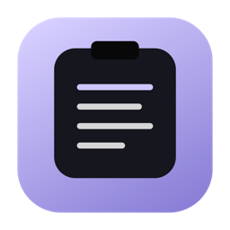
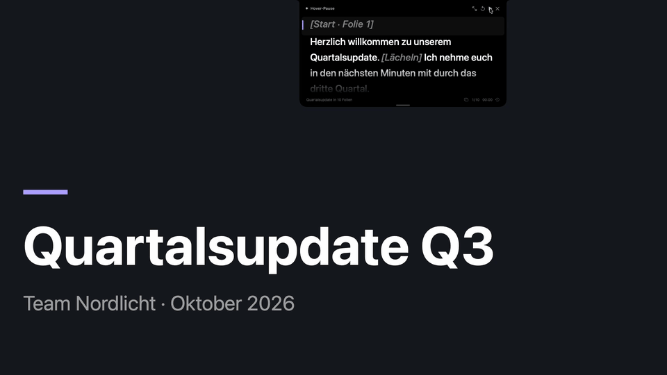
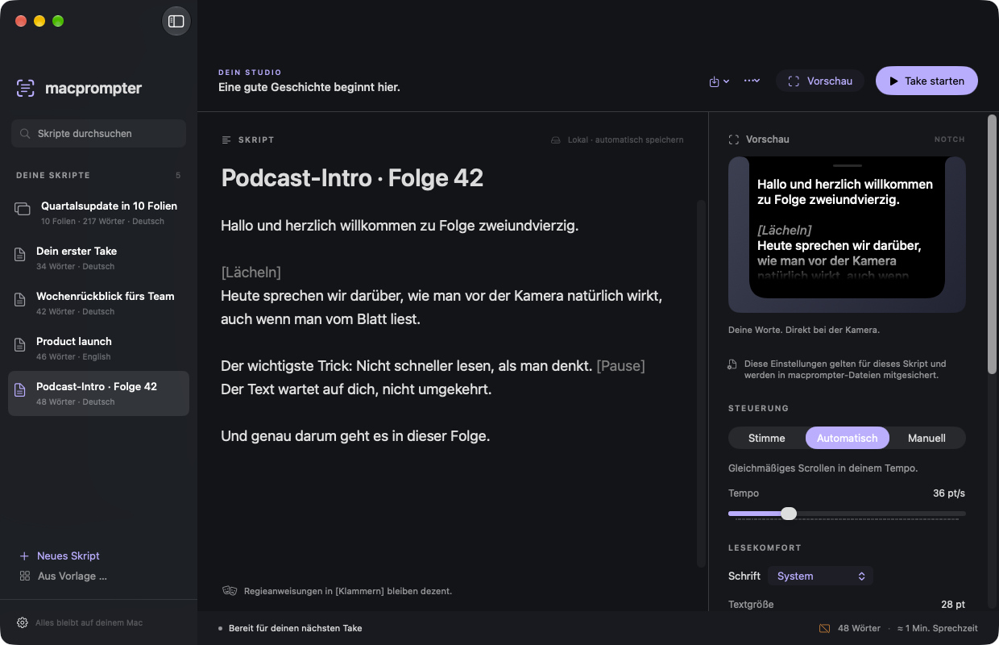
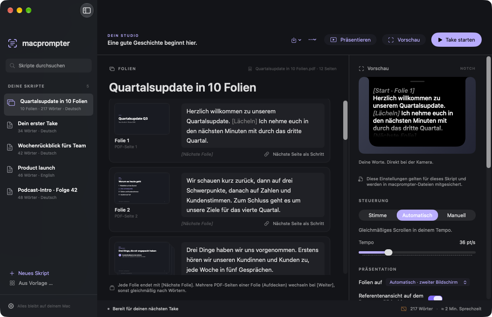
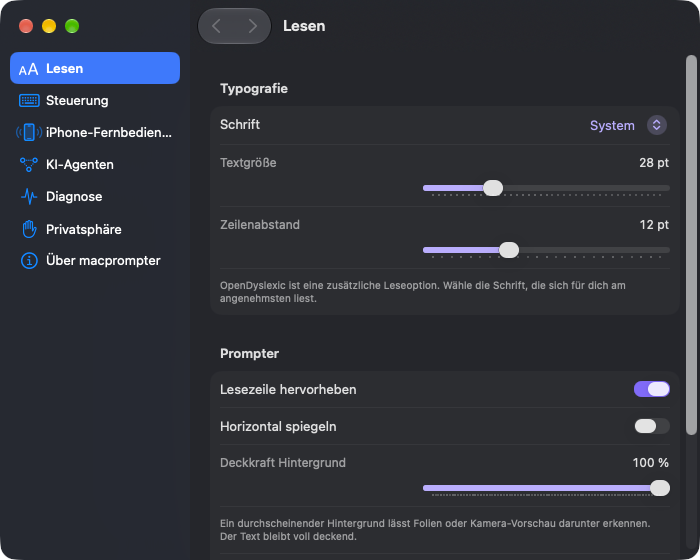

<p align="center"></p>

<h1 align="center">macprompter</h1>

<p align="center"><b>Der Teleprompter an deiner Notch.</b><br>Er folgt deiner Stimme, wechselt deine Folien und bleibt komplett auf deinem Mac.</p>

<p align="center">
<a href="https://github.com/FNG-2002/macprompter/releases/latest"></a>
<a href="https://github.com/FNG-2002/macprompter/actions/workflows/ci.yml"></a>

<a href="LICENSE"></a>
</p>

<p align="center"></p>

<p align="center"><a href="docs/media/macprompter-demo.mp4">▶ Demo-Video (41 s, ohne Ton)</a></p>

> **In English:** macprompter is a free, open-source teleprompter for macOS 26+. The script sits right below your camera at the notch, scrolls at your pace or follows your voice word by word using Apple's on-device speech recognition (every language Apple's on-device dictation offers, e.g. German, English, French, Spanish, Turkish), and can drive your PDF slides. No account, no cloud, no telemetry. The interface is currently German only.

## Was macprompter kann

- **Text direkt an der Kamera.** Der Prompter hängt an der Notch oder schwebt frei, über allen Fenstern und Vollbild-Apps, ohne dass macprompter den Fokus stiehlt.
- **Folgt deiner Stimme.** Im Modus *Stimme* markiert macprompter das Wort, das du gerade sagst, dunkelt Gelesenes ab und scrollt mit. Auslassen, versprechen, kurz abschweifen: Er findet zurück und läuft beim freien Reden nicht weiter. In allen Sprachen von Apples lokalem Diktat, zum Beispiel Deutsch, Englisch, Französisch, Spanisch oder Türkisch.
- **Oder im eigenen Tempo.** Modus *Automatisch* mit einstellbarer Geschwindigkeit, Modus *Manuell* per Tasten, Scrollrad oder iPhone.
- **Maus drüber heißt Pause.** Sobald der Zeiger über dem Prompter liegt, steht alles still.
- **Präsentationen.** PDF importieren, Sprechtext pro Folie schreiben, präsentieren: Die Folien wechseln mit deinem Text, auf Wunsch mit Referentenansicht auf dem zweiten Bildschirm. Eine neu exportierte PDF behält die Texte.
- **Angenehm zu lesen.** Fünf Schriften (darunter Serif, Mono und OpenDyslexic), Größen, Textfarben, Zeilenabstand, Lesezeile, Spiegelung und durchscheinender Hintergrund, mit Live-Vorschau. `[Regieanweisungen]` bleiben dezent grau.
- **Für KI-Assistenten.** Optionaler lokaler MCP-Zugang: Claude & Co. können Skripte und Folientexte für dich anlegen ([docs/MCP.md](docs/MCP.md)).
- **Privat.** Kein Konto, keine Cloud, keine Telemetrie. Audio wird nie gespeichert. Die einzige Internetverbindung ist die abschaltbare Update-Suche.

| | |
| --- | --- |
|  |  |
| Bibliothek mit Vorschau und Einstellungen pro Skript | Folien-Editor: Sprechtext pro Folie, Aufdeck-Schritte |
|  |  |
| Präsentation mit Prompter oben an der Kamera | Einstellungen |

## Installation

1. Die neueste `macprompter-x.y.z.dmg` unter [Releases](https://github.com/FNG-2002/macprompter/releases/latest) laden, öffnen und macprompter in „Programme“ ziehen.
2. **Erster Start:** macprompter ist signiert, aber noch nicht von Apple notarisiert (dafür bräuchte es eine kostenpflichtige Apple-Mitgliedschaft). macOS blockiert deshalb den ersten Start:
   - App öffnen, die Meldung „Apple konnte nicht überprüfen …“ mit „Fertig“ schließen.
   - **Systemeinstellungen → Datenschutz & Sicherheit**, ganz unten bei macprompter **„Dennoch öffnen“** wählen und bestätigen.
   - Oder im Terminal: `xattr -dr com.apple.quarantine /Applications/macprompter.app`
3. Fertig. Die Bibliothek startet leer; unter **Aus Vorlage …** (⇧⌘N) liegen Beispielskripte und eine Beispielpräsentation.

**Voraussetzungen:** macOS 26 oder neuer. Entwickelt und getestet auf Apple Silicon; der Build ist universell, Intel-Macs sind ungetestet. Für die Sprachsteuerung lädt macOS beim ersten Take gegebenenfalls Apples Sprachmodell (einmalig, verwaltet von macOS).

**Updates:** Ab 1.1.0 fragt die App einmal am Tag bei GitHub nach der neuesten Versionsnummer und zeigt in der Bibliothek einen Hinweis, wenn es eine neue Version gibt (Hilfe → „Nach Updates suchen …“ prüft sofort, abschaltbar unter Einstellungen → Über macprompter). Installiert wird nichts automatisch: Die neue DMG von [Releases](https://github.com/FNG-2002/macprompter/releases) laden und installieren. Skripte, Einstellungen und Freigaben bleiben erhalten.

## Erste Schritte

1. **Skript anlegen** (⌘N) oder importieren (⌘O: TXT, Markdown, RTF, `.macprompter`). Alles speichert automatisch.
2. **Modus wählen:** *Stimme*, *Automatisch* oder *Manuell*. Die Einstellungen in der rechten Spalte gelten pro Skript.
3. **Take starten** mit dem Knopf oder ⌥⌘P. Nach dem Countdown läuft der Text.
4. **Pausieren:** Maus über den Prompter oder ⌥⌘P. ⌥⌘H blendet ihn sofort aus und schaltet das Mikrofon ab.
5. **Präsentieren:** PDF importieren (⇧⌘O), Text pro Folie schreiben, ⌘↩.

| Taste | Aktion |
| --- | --- |
| ⌥⌘P | Start / Pause (überall) |
| ⌥⌘H | Sofort ausblenden und Mikrofon stoppen (überall) |
| ⌥⌘↑ / ↓ | Zurück / Weiter (überall) |
| ⌥⌘← / → | Folie zurück / weiter (während einer Präsentation) |
| ⌘N / ⇧⌘N | Neues Skript / aus Vorlage |
| ⌘O / ⇧⌘O | Öffnen bzw. importieren / PDF-Präsentation importieren |
| ⇧⌘S | Als macprompter-Datei sichern (Skript, Folien und Einstellungen in einer Datei) |
| ⌘↩ | Präsentieren / beenden |
| ⌘, | Einstellungen |

Die globalen Tastenkürzel brauchen keine Bedienungshilfen-Freigabe. Das Scrollrad steuert den Prompter auch, wenn der Zeiger in einer anderen App liegt; dafür fragt macOS einmal nach der Freigabe „Eingabeüberwachung“ (macprompter liest damit nur Scroll-Ereignisse, keine Tasten). Abschaltbar unter Einstellungen → Steuerung.

## Sprachsteuerung: was sie kann und was nicht

macprompter nutzt Apples Diktiermodell (`SpeechAnalyzer`) auf dem Gerät und gibt ihm Namen und Fachbegriffe aus deinem Skript als Vokabular mit. Die Position im Skript bestimmen ausschließlich erkannte Wörter. Damit die Markierung nicht hinter der Stimme herläuft, zieht sie in deinem Tempo bis zu zwei Wörter vor, solange du sprichst und auf dem Skript bist (Einstellungen → Lesen → „Markierung im Sprechtempo vorziehen“, abschaltbar). Unterschiedliche Schreibweisen („drei“/„3“, „Dr.“, „E-Mail“/„email“) gelten als dasselbe Wort. Bei Zwischenfragen oder Anekdoten hält der Text die Position; beim Wiedereinstieg reichen ein paar eindeutige Wörter. Leicht umformulierte Sätze erkennen Apples lokale Satzmodelle im Hintergrund.

Grenzen: Ein Wort erscheint typischerweise etwa eine halbe Sekunde nach dem Aussprechen. Andere Stimmen, die Skriptwörter sagen, können ebenfalls Fortschritt auslösen. Optional gleitet der Text zwischen erkannten Wörtern in deinem Tempo weiter (Einstellungen → Lesen → „Im Sprechtempo scrollen“, höchstens drei bis vier Wörter voraus). Details und Messwerte: [Wortausrichtung](docs/SPEECH_FOLLOWING.md), [Messbericht](docs/SPEECH_LATENCY_RESULTS.md), [Satzmodelle](docs/SEMANTIC_RECOVERY.md).

## Privatsphäre und Daten

- Skripte (`scripts.json`) und Kopien verknüpfter PDFs liegen im Application-Support-Ordner der sandboxed App (Einstellungen → Privatsphäre → Skriptordner öffnen). Eine beschädigte Bibliothek wird nie überschrieben.
- Das Mikrofon läuft nur während eines Takes im Modus Stimme. Audio und Transkripte werden weder gespeichert noch geloggt; die Diagnose kennt nur Zahlen.
- Ins Internet verbindet sich die App nur für die Update-Suche: einmal am Tag eine Anfrage an die GitHub-API nach der neuesten Versionsnummer, ohne Daten über dich oder deine Skripte; GitHub sieht dabei deine IP-Adresse. Abschaltbar unter Einstellungen → Über macprompter. Sprachmodelle lädt macOS selbst. Lokales Netz nutzt die App nur, wenn du es einschaltest: die iPhone-Fernbedienung und den MCP-Zugang auf `127.0.0.1`.

**Aufnahmeschutz ist keine Garantie.** Das Overlay setzt `NSWindow.sharingType = .none`, aber moderne Aufnahme- und Konferenz-Apps (ScreenCaptureKit) können das ignorieren; Apple bietet keinen universellen Schutz ([Apple DTS, Juli 2025](https://developer.apple.com/forums/thread/792152)). Vor einem Termin mit genau deiner App testen, lieber ein einzelnes Fenster teilen oder den Prompter auf einen nicht geteilten Bildschirm legen.

## iPhone-Fernbedienung

Die iOS-App **macprompter Remote** steuert Start, Pause, Tempo, Scrollen und Folien im lokalen Netz, verschlüsselt und per sechsstelligem Code gekoppelt ([docs/REMOTE.md](docs/REMOTE.md)). Sie ist nicht im App Store; du kannst sie mit Xcode selbst auf dein iPhone bringen (siehe unten). Am Mac unter Einstellungen → iPhone-Fernbedienung einschalten.

## Mit KI entwickelt

macprompter entsteht überwiegend mit KI-Coding-Agents (vor allem Claude Code). Der Maintainer gibt Richtung und Anforderungen vor, testet die App im Alltag und entscheidet über Releases und Beiträge; jede Änderung muss rund 258 automatische Tests bestehen. Die App selbst nutzt keine Cloud-KI. Ausführlich: [docs/AI.md](docs/AI.md).

## Selbst bauen

Voraussetzungen: macOS 26+, Xcode 26+. Keine Fremdpakete.

```sh
git clone https://github.com/FNG-2002/macprompter.git && cd macprompter
scripts/check.sh                 # Debug-Build + alle Tests + iOS-Simulator-Build
open MacPrompter.xcodeproj       # Schema „macprompter“, Ziel „My Mac“
scripts/install.sh               # geprüfte Release-Version nach /Applications
```

`scripts/install.sh` signiert mit dem Projektzertifikat, falls es im Schlüsselbund liegt (nur beim Maintainer, dann identisch mit den Releases), sonst mit einem vorhandenen „Apple Development“-Zertifikat, damit Freigaben Updates überstehen, sonst ad hoc. `scripts/check.sh` erzeugt vorher die Testaudios mit den macOS-Stimmen (`scripts/make_fixtures.sh`); in Xcode direkt testen erst danach. Nach neuen oder gelöschten Dateien `python3 scripts/generate_project.py` ausführen; das Xcode-Projekt wird generiert.

**iPhone-App:** Schema „macprompter Remote“. Für ein echtes Gerät `MacPrompterRemote/Signing.local.xcconfig` mit `DEVELOPMENT_TEAM = <Team-ID>`, `CODE_SIGN_STYLE = Automatic` und `CODE_SIGN_IDENTITY = Apple Development` anlegen (bei Bedarf eigene `PRODUCT_BUNDLE_IDENTIFIER`). Details: [docs/REMOTE.md](docs/REMOTE.md).

**Tests:** 258 XCTests prüfen Wortausrichtung, Bewegungssperre, Speicher, Präsentationen, Fernbedienung samt verschlüsseltem Loopback-Durchlauf, MCP und lokale Spracherkennung mit synthetischem Audio (ohne installiertes Modell übersprungen). Mikrofon mit echter Sprache, mehrere Displays und Konferenz-Apps lassen sich nicht automatisch prüfen: [docs/VALIDATION.md](docs/VALIDATION.md).

| Dokument | Inhalt |
| --- | --- |
| [AGENTS.md](AGENTS.md) | Verbindliche Regeln für Agents und Menschen, Produktprinzipien |
| [docs/ARCHITECTURE.md](docs/ARCHITECTURE.md) | Aufbau, Datenfluss, Nebenläufigkeit |
| [docs/DECISIONS.md](docs/DECISIONS.md) | Produkt- und Architekturentscheidungen |
| [docs/SPEECH_FOLLOWING.md](docs/SPEECH_FOLLOWING.md) · [docs/SEMANTIC_RECOVERY.md](docs/SEMANTIC_RECOVERY.md) | Sprachführung und Satzmodelle |
| [docs/RENDERING_OPTIMIZATION.md](docs/RENDERING_OPTIMIZATION.md) | Scrollen und Darstellung |
| [docs/PRESENTATIONS.md](docs/PRESENTATIONS.md) · [docs/REMOTE.md](docs/REMOTE.md) · [docs/MCP.md](docs/MCP.md) | Präsentationen, iPhone-Fernbedienung, KI-Agenten |
| [docs/SPEECH_LATENCY_RESULTS.md](docs/SPEECH_LATENCY_RESULTS.md) · [docs/VALIDATION.md](docs/VALIDATION.md) | Messberichte und Abnahmen |
| [docs/RELEASING.md](docs/RELEASING.md) · [docs/MEDIA.md](docs/MEDIA.md) | Releases, Screenshots und Demo-Video |
| [CHANGELOG.md](CHANGELOG.md) | Alle Änderungen |

## Mitmachen

Fehler und Ideen gern als [Issue](https://github.com/FNG-2002/macprompter/issues/new/choose), Code als Pull Request aus deinem Fork. Über Merges entscheidet der Maintainer. Bitte vorher [CONTRIBUTING.md](CONTRIBUTING.md) lesen; Sicherheitslücken vertraulich nach [SECURITY.md](SECURITY.md).

## Lizenz und Danksagungen

macprompter steht unter der [MIT-Lizenz](LICENSE). © 2026 [FNG-2002](https://github.com/FNG-2002).

- [OpenDyslexic](https://opendyslexic.org) von Abbie Gonzalez, SIL Open Font License 1.1.
- Notch-Form und Agent-Skills nach [macos-app-skills](https://github.com/fayazara/macos-app-skills) von Fayaz Ahmed, MIT.
- Inspiration für den Funktionsumfang: [Moody](https://moody.mjarosz.com/) und [NotchPrompter](https://notchprompter.com/); eigenständige Implementierung ohne übernommenen Code.
- [Apple WWDC25: SpeechAnalyzer](https://developer.apple.com/videos/play/wwdc2025/277/).

Vollständige Liste: [THIRD_PARTY_NOTICES.md](THIRD_PARTY_NOTICES.md).
